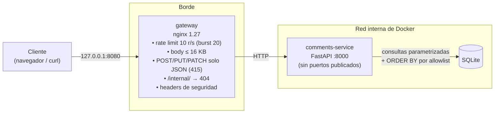
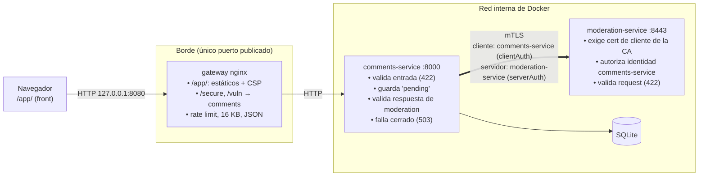

# Arquitectura

## Etapa 1



Vista en capas del servicio, con los tres retos:

```
request ─► gateway ─► FRONTERA DEL SERVICIO ───────► DOMINIO ──► SINKS / SALIDA ─────────────────► response
           (grueso)    tipos y schemas (422)                     SQL: valores con ?, estructura de dicts propios
                       Reto 1: sort ∈ Literal[id, author]        Reto 1: SORT_COLUMNS / SORT_DIRECTIONS
                               direction ∈ {asc, desc}           Reto 2: csv.writer + spreadsheet_cell
                       Reto 3: safe_redirect_target → "/"        Reto 3: RedirectResponse(destino validado)
```

| Capa | Control | Reto | Archivo |
|---|---|---|---|
| Borde | Rate limit, tamaño, content type, bloqueo de `/internal/`. No mira el contenido: no frena ninguno de los tres | — | `gateway/nginx.conf` |
| Frontera | `sort: Literal["id","author"]`; `direction` con `max_length=4` y búsqueda case-insensitive en un diccionario; si no está → `422` sin consultar | 1 | `routes_secure.py` |
| Frontera | `safe_redirect_target`: path relativo, sin esquema/host, sin `\`, sin control chars, sin `..`, prefijo en `("/app/", "/secure/")`; si no → `/` | 3 | `validation.py` |
| Sink SQL | El texto del `ORDER BY` sale de `SORT_COLUMNS`/`SORT_DIRECTIONS`, nunca de la entrada | 1 | `routes_secure.py` |
| Salida | `csv.writer(quoting=QUOTE_ALL)` (estructura) + `encoding.spreadsheet_cell` (fórmulas), aplicado al exportar | 2 | `encoding.py`, `routes_secure.py` |

### Componentes elegidos

Mantengo los componentes del material (nginx, FastAPI + Pydantic, SQLite). Lo evalué así:

- **nginx como gateway.** Lo que se le pide al borde en este proyecto (rate limit, tope de body, filtro de content type, bloquear una ruta, headers) son cinco directivas conocidas y fáciles de auditar. Traefik o Envoy suman descubrimiento de servicios y configuración dinámica, que acá no se usan, a cambio de más superficie. Caddy simplificaría TLS automático, que en local no aplica.
- **¿Y un WAF?** Lo probé (bonus, `gateway/waf.compose.yml`): ModSecurity + OWASP CRS bloquea el payload del reto 1 pero **no** los de los retos 2 y 3 (ver `RESPUESTAS.md`, pregunta 5). Es un complemento válido si hubiera tráfico real, pero no lo dejo como gateway por defecto: en paranoia 1 deja pasar lo que importa acá, en paranoias altas genera falsos positivos con texto enriquecido (los comentarios aceptan `<b>` y links), y su costo de tuning no se justifica para la demo. Queda como override opcional.
- **FastAPI + Pydantic**: la validación en la frontera se declara en el tipo del parámetro (`Literal`, `Query(max_length=...)`) y el `422` sale solo, antes de ejecutar el handler.
- **SQLite**: alcanza para la demo; la regla de diseño (valores parametrizados, estructura por allowlist) es la misma para cualquier motor.

## Etapa 2



### Qué protege cada tramo

| Tramo | Protección | Nota |
|---|---|---|
| navegador ⇄ gateway | HTTP en `127.0.0.1` | En producción sería HTTPS terminado en el gateway; para la demo local no se agrega |
| gateway ⇄ comments-service | HTTP en la red interna | comments-service no tiene puertos publicados |
| **comments-service ⇄ moderation-service** | **mTLS** | Ambos extremos se autentican con certificados de la CA del proyecto. comments-service verifica el SAN `moderation-service`; moderation exige certificado de cliente y además que la identidad sea `comments-service` (bonus) |
| moderation-service ⇄ afuera | No existe | Sin `ports` en compose ni `location` en el gateway (probado: `localhost:8443` no conecta, `/moderate` por el gateway da 404) |

### Dónde se valida y dónde se codifica

```
             VALIDA                                  CODIFICA / SANEA
navegador    form: pattern/maxlength (solo UX)       DOMPurify (comentarios), textContent (filtro, reason, estados)
gateway      tamaño, content type, rate limit        CSP en /app/ (defensa en profundidad)
comments     CommentIn estricto (422)                comments.json devuelve el dato crudo (lo codifica quien renderiza)
             ModerationVerdict estricto (respuesta)  /secure/comments (HTML server-side): nh3 + autoescape
moderation   ModerationRequest estricto (422)        —
```

| Dónde | Qué se valida | Qué pasa si falla |
|---|---|---|
| Front (`index.html`) | `pattern`, `maxlength`, `required` | Mensaje al usuario. **No es seguridad**: se saltea con curl |
| comments-service, entrada | `CommentIn`: autor `^[a-z0-9_]{3,20}$`, body ≤ 2000, sin control chars, `extra="forbid"` | `422`, no se guarda |
| moderation-service, entrada | `ModerationRequest`: mismos límites + `comment_id` entero ≥ 1, `strict` (sin coerción) | `422`, aunque el certificado sea válido |
| comments-service, **respuesta** de moderation | `ModerationVerdict`: `status ∈ {approved, rejected}`, `reason` ≤ 200, sin extras, `strict`; HTTP 200; ≤ 4 KB | Respuesta inválida = no hay veredicto → el comentario queda `pending`, `503` |
| Front, salida | El `reason` de moderation y los estados se muestran con `textContent` | — |

**Fallar cerrado:** el comentario se inserta como `pending` antes de llamar a moderation y solo pasa a `approved` con un veredicto válido. Elegí guardarlo pendiente (en vez de descartarlo) para no perder el texto del usuario y poder reintentar la moderación o revisarlo a mano; el cliente recibe `503` con `status: pending`, y todas las salidas `/secure` (`comments.json`, `/secure/comments`, `sorted`, `search`, `export.csv`) filtran `status = 'approved'`. El costo es que pueden acumularse filas pendientes: en un sistema real habría un reintento con backoff o una cola.

### Componentes elegidos en la etapa 2

- **moderation-service con FastAPI + Pydantic**, el mismo stack que comments-service: el contrato se expresa como schema estricto en ambos lados con la misma herramienta.
- **mTLS en uvicorn, sin sidecar.** La consigna sugiere un nginx delante de moderation para el bonus de identidad. Lo evalué y preferí hacerlo en el propio proceso: uvicorn ya exige el certificado (`CERT_REQUIRED`), y la autorización por identidad son ~20 líneas en una subclase del protocolo HTTP de uvicorn (`AuthorizedH11Protocol`), que lee el certificado verificado apenas termina el handshake. Con un sidecar, moderation quedaría escuchando HTTP plano detrás de él y confiando en un header con el DN del cliente, lo que obliga a aislarlo en otra red para que nadie pueda mandar ese header directo. Menos piezas, menos configuración que auditar. El costo: depende de un detalle interno de uvicorn (la clase `H11Protocol`), por eso la versión de uvicorn queda fijada en `moderation-service/requirements.txt`.
- **DOMPurify servido localmente** (`front/purify.min.js`, 3.2.6, integridad sha512 verificada contra el registry de npm): la CSP solo permite scripts del mismo origen.
- **nginx** se mantiene como gateway; se le agregó `include mime.types` (sin eso servía `app.js` como `text/plain` y, con `nosniff`, el navegador no lo ejecutaba) y la CSP de `/app/`.
