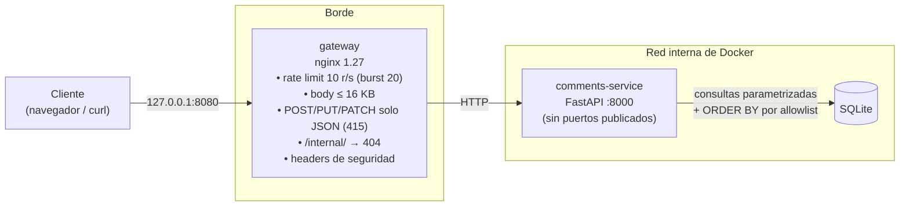

# Arquitectura

## Etapa 1



Vista en capas del servicio, con los tres retos:

```
request ─► gateway ─► FRONTERA DEL SERVICIO ───────► DOMINIO ──► SINKS / SALIDA ─────────────────► response
           (grueso)    tipos y schemas (422)                     SQL: valores con ?, estructura de dicts propios
                       Reto 1: sort ∈ Literal[id, author]        Reto 1: SORT_COLUMNS / SORT_DIRECTIONS
                               direction ∈ {asc, desc}           Reto 2: csv.writer + spreadsheet_cell
                       Reto 3: safe_redirect_target → "/"        Reto 3: RedirectResponse(destino validado)
```

| Capa | Control | Reto | Archivo |
|---|---|---|---|
| Borde | Rate limit, tamaño, content type, bloqueo de `/internal/`. No mira el contenido: no frena ninguno de los tres | — | `gateway/nginx.conf` |
| Frontera | `sort: Literal["id","author"]`; `direction` con `max_length=4` y búsqueda case-insensitive en un diccionario; si no está → `422` sin consultar | 1 | `routes_secure.py` |
| Frontera | `safe_redirect_target`: path relativo, sin esquema/host, sin `\`, sin control chars, sin `..`, prefijo en `("/app/", "/secure/")`; si no → `/` | 3 | `validation.py` |
| Sink SQL | El texto del `ORDER BY` sale de `SORT_COLUMNS`/`SORT_DIRECTIONS`, nunca de la entrada | 1 | `routes_secure.py` |
| Salida | `csv.writer(quoting=QUOTE_ALL)` (estructura) + `encoding.spreadsheet_cell` (fórmulas), aplicado al exportar | 2 | `encoding.py`, `routes_secure.py` |

### Componentes elegidos

Mantengo los componentes del material (nginx, FastAPI + Pydantic, SQLite). Lo evalué así:

- **nginx como gateway.** Lo que se le pide al borde en este proyecto (rate limit, tope de body, filtro de content type, bloquear una ruta, headers) son cinco directivas conocidas y fáciles de auditar. Traefik o Envoy suman descubrimiento de servicios y configuración dinámica, que acá no se usan, a cambio de más superficie. Caddy simplificaría TLS automático, que en local no aplica.
- **¿Y un WAF?** Lo probé (bonus, `gateway/waf.compose.yml`): ModSecurity + OWASP CRS bloquea el payload del reto 1 pero **no** los de los retos 2 y 3 (ver `RESPUESTAS.md`, pregunta 5). Es un complemento válido si hubiera tráfico real, pero no lo dejo como gateway por defecto: en paranoia 1 deja pasar lo que importa acá, en paranoias altas genera falsos positivos con texto enriquecido (los comentarios aceptan `<b>` y links), y su costo de tuning no se justifica para la demo. Queda como override opcional.
- **FastAPI + Pydantic**: la validación en la frontera se declara en el tipo del parámetro (`Literal`, `Query(max_length=...)`) y el `422` sale solo, antes de ejecutar el handler.
- **SQLite**: alcanza para la demo; la regla de diseño (valores parametrizados, estructura por allowlist) es la misma para cualquier motor.
